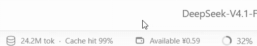

# Credit meter

English | [Chinese](README.zh.md)


A DeepSeek Harness plugin that shows the remaining DeepSeek account credit as
one more reading in the composer dock — the row under the message input that
already carries activity, token usage, and the context meter.



## What it shows

`Available ¥1.91` next to a small wallet glyph. Hovering the reading, or
reading it with a screen reader, lists the wallets behind that number:

```
Account credit
Available ¥1.91
Recharge ¥1.91
```

The labels are localized, so the reading follows the language of the UI.

## Where it appears

One entry in the session's composer dock, after the token-usage reading and
before the context meter. The value is account-wide, so switching sessions does
not change it.

DSH does not render the dock on a blank home screen, so the reading starts with
the first message of a session.

## When it refreshes

- When the session's billed tokens change — about two seconds after a step settles.
- Once a minute while the page is visible.
- Immediately when the window regains focus, and once on page load.

DeepSeek Platform can take a while to book a request into the balance it
reports, so a just-finished turn may still show the previous amount for up to
about a minute.

## What the number means

Platform reports one wallet per currency and keeps recharge and bonus separate.
The reading is the spendable total of the best-funded currency:

- recharge plus bonus of that currency;
- a zero wallet in another currency never wins over a funded one;
- every other funded currency is appended, for example `Available ¥1.91 +$5.00`;
- formatting follows the Platform Web client: two decimals rounded down, and
  `<¥0.01` below one cent.

The tooltip lists funded wallets only, so a bonus-only account reads
`Bonus ¥2.00` there.

## Requirements

- DeepSeek Harness `0.2.2-rc.2` or a compatible release (`engines.dsh`).
- Signed in to a DeepSeek account in DSH.
- The Web GUI or the Desktop app.

## Install

From a local directory (the current state of this package):

1. Keep this directory where it is; DSH links it instead of copying it.
2. In DSH, open **Plugins → Add plugin** and choose this directory. The agent
   equivalent is `plugin_manager` with `install_bundle` and the absolute path.
3. Refresh the page once if it was already open, then send a message.

From npm (only after this package is published; see [PUBLISHING.md](PUBLISHING.md)):

1. **Plugins → Add plugin**, then enter `dsh-credit-meter@1.0.0`.

## Privacy

The reading comes from the same account query Settings → Account uses
(`ctx.remote.account.getBalance`). The plugin:

- never reads, copies, or stores the account token;
- sends no data anywhere else and adds no telemetry;
- keeps the last value in memory only, and drops it when the plugin is disabled.

Disabling the plugin in **Plugins** removes the reading and stops the queries.

## Limitations

- Display only: the reading has no click target and no top-up link.
- Refreshes on the cadence above, not continuously.
- Account-wide by design; it is not a per-session cost meter.
- A failed read keeps the last value and marks it stale in the tooltip.
- Nothing is shown before the first read completes, or while signed out.

## Development

There is no build step. `client.js` is the browser bundle DSH loads as-is: it
registers a lazy factory through `window.__ModuleLoader__.load` and resolves
React from the shell's module table.

```
.
├── package.json        package identity, bundle patch, client declaration
├── cordis.patch.yml    inserts the plugin row into the runtime
├── index.js            Host half (intentionally empty)
├── client.js           browser half: querying, formatting, dock entry
├── docs/               feature preview and detail document
├── locale/             plugin-page title and description
├── icon.svg            plugin-page icon
├── README.md           this file
├── README.zh.md        Chinese README
├── PUBLISHING.md       release checklist
└── LICENSE             MIT
```

Edit `client.js`, check it with `node --check client.js`, and refresh the page.
DSH does not hot-replace the code of a package that is already running, so a
reload is required for a change to take effect.

## License

[MIT](LICENSE)
