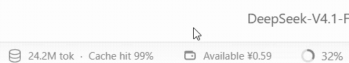

# Credit meter（账户额度读数）

[English](README.md) | 中文


一个 DeepSeek Harness 插件：把 DeepSeek 账户剩余额度显示在输入框下方那行读数里。
那一行原本就有活动统计、token 用量和上下文占用。



## 显示什么

钱包图标旁边是 `可用余额 ¥1.91`。鼠标悬停（或读屏软件读取）会列出这个数字背后的钱包：

```
账户额度
可用余额 ¥1.91
充值 ¥1.91
```

英文界面显示为 `Available ¥1.91`。

## 出现在哪里

会话输入框下方读数行里的一项，排在 token 用量之后、上下文占用之前。这个数值属于整个账户，
所以切换会话不会改变它。

DSH 的空白首页不渲染这行读数，因此它从会话的第一条消息开始出现。

## 什么时候刷新

- 本会话的计费 token 变化时——一步结束后大约 2 秒。
- 页面可见时，每分钟一次。
- 窗口重新获得焦点时立刻一次，页面加载时一次。

DeepSeek 平台把一次请求记进余额需要时间，所以刚结束的一轮可能还会显示旧金额，最长约一分钟。

## 数字的含义

平台按币种分别返回钱包，充值和赠送分开记。读数取"最有钱的那个币种"的可花总额：

- 该币种的充值 + 赠送；
- 另一个币种金额为 0 时，不会盖过有余额的币种；
- 其他有余额的币种会追加在后面，例如 `可用余额 ¥1.91 +$5.00`；
- 格式与 Platform 网页端一致：两位小数向下取整，不足一分显示 `<¥0.01`。

悬停提示只列有余额的钱包，所以只有赠送额度时那里显示 `赠送 ¥2.00`。

## 运行要求

- DeepSeek Harness `0.2.2-rc.2` 或兼容版本（见 `engines.dsh`）。
- 在 DSH 中已登录 DeepSeek 账户。
- Web 界面或桌面端。

## 安装

从本地目录安装（当前这个包的状态）：

1. 把这个目录留在原处；DSH 是链接它，而不是复制。
2. 在 DSH 里打开 **Plugins（插件）→ Add plugin（添加插件）**，选择这个目录。
   用 Agent 的等价做法是 `plugin_manager` 的 `install_bundle`，参数为绝对路径。
3. 如果页面本来开着，先刷新一次，然后发一条消息。

从 npm 安装（需要这个包已经发布，见 [PUBLISHING.md](PUBLISHING.md)）：

1. **Plugins → Add plugin**，输入 `dsh-credit-meter@1.0.0`。

## 隐私

读数和设置页的账户余额来自同一个查询（`ctx.remote.account.getBalance`）。本插件：

- 从不读取、复制或保存账户凭据（token）；
- 不向其他地方发送数据，也不加任何遥测；
- 只在内存里保留最近一次数值，插件被禁用时即丢弃。

在 **Plugins** 里关掉插件，读数和余额请求都会停止。

## 已知限制

- 只做展示：读数不能点击，也没有充值链接。
- 按上面的节奏刷新，不是连续实时。
- 按设计属于整个账户，不是"本会话花了多少"的计量器。
- 读取失败时保留上一个数值，并在悬停提示里标注可能过期。
- 首次读取完成前、未登录时不显示。

## 开发

没有构建步骤。`client.js` 就是 DSH 直接加载的浏览器包：它通过
`window.__ModuleLoader__.load` 登记一个惰性工厂，并从外壳的模块表里取 React。

```
.
├── package.json        包身份、bundle patch、client 声明
├── cordis.patch.yml    把插件行插入运行时
├── index.js            Host 半（有意为空）
├── client.js           浏览器半：取数、格式化、dock 条目
├── docs/               效果图与插件详情文档
├── locale/             插件页的标题与描述
├── icon.svg            插件页图标
├── README.md           英文 README
└── README.zh.md        本文件
```

改完 `client.js` 用 `node --check client.js` 检查，然后刷新页面。
DSH 不会热替换已经在运行的包代码，所以必须重载页面才会生效。

## 许可证

[MIT](LICENSE)
